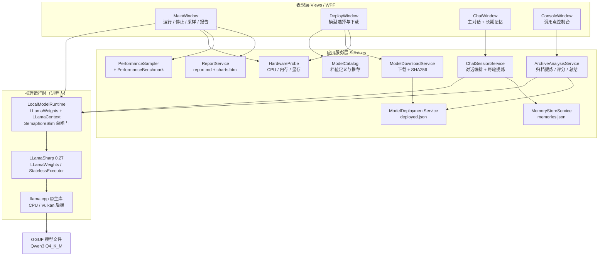

<p>
  <a href="README.md"></a>
  <a href="docs/README-en-US.md"></a>
  <a href="docs/README-ja-JP.md"></a>
</p>

# kfupet-local-chat

> ⚠️ Important: This is **NOT the KfuPet desktop pet main project** .
>
> 本项目**不是 KfuPet 桌宠本体**，是配套独立的本地 AI 聊天核心与试点台。

## 📖 项目介绍

本项目是一个**纯本地**的大模型聊天实现：不调用任何云端 AI 接口，模型以 GGUF 文件形式存放在本机，推理由内置的 llama.cpp 原生库在应用进程内完成。

它同时承担两个角色：

- KfuPet 桌宠接入本地模型的**底层参考底座**；
- 本地模型能力、记忆提炼与性能表现的**试点验证台**。

代码按表现层、服务层、推理运行时分层，便于直接移植到其他 .NET 项目。

## ✨ 功能一览

| 功能         | 说明                                                  |
| ---------- | --------------------------------------------------- |
| 三档本地模型     | Qwen3-1.7B / 4B / 8B，统一 Q4\_K\_M 量化，按本机显存与内存标注可运行状态 |
| 模型下载与多模型管理 | 支持自定义存放目录、多地址回退下载、边下边算 SHA256、多模型共存与切换              |
| 推理设备选择     | 自动（按显存判断）/ GPU 加速 / 纯 CPU，选择结果持久化                   |
| 主对话        | 多轮聊天，人设提示词 + 长期记忆注入，每轮回复后立即做一次核心信息提炼                |
| 调试控制台      | 按主项目调用点逐项回放：触摸反应、主动搭话、归档批量提炼、单条重评分、多条总结等            |
| 性能观测       | 运行期间每秒采样 CPU / 内存 / GPU 利用率 / 显存 / 温度 / 功耗 / 频率     |
| 运行报告       | 完整运行一次后可导出 ZIP，内含 Markdown 报告与自包含 HTML 图表           |
| 硬件探测       | 读取 CPU、内存、独显型号与真实显存                                 |

## 🏗️ 整体架构

项目是 **.NET 8 + WPF 的单进程桌面应用**。没有本地 HTTP 服务、没有独立推理进程，llama.cpp 以原生动态库形式被加载进当前进程。



### 分层职责

| 层     | 位置                                                      | 职责                                      |
| ----- | ------------------------------------------------------- | --------------------------------------- |
| 表现层   | [MainWindow.xaml.cs](MainWindow.xaml.cs)、[Views](Views) | 窗口与卡片布局、按钮分发、运行状态展示、动画与日志               |
| 应用服务层 | [Services](Services)                                    | 模型目录、下载部署、硬件探测、对话编排、记忆存储、归档分析、性能采样、报告生成 |
| 推理运行时 | [LocalModelRuntime.cs](Services/LocalModelRuntime.cs)   | 加载 GGUF、创建上下文、串行推理、指标统计、释放显存            |
| 原生推理  | LLamaSharp + llama.cpp                                  | 实际张量计算，按 `GpuLayerCount` 决定卸载到 GPU 的层数  |
| 数据模型  | [Models](Models)                                        | 部署记录、硬件信息、运行记录、记忆条目等纯数据对象               |

### 关键设计约束

- **纯本地**：不引用任何云端模型 API，断网也能完成下载后的全部功能。
- **进程内推理**：不依赖 Ollama 等外部服务，用户无需额外安装运行时。
- **单闸门推理**：`LocalModelRuntime` 用 `SemaphoreSlim(1,1)` 串行化所有推理请求，避免多个窗口同时抢占同一份原生上下文。
- **状态不硬编码**：界面上的“已启动 / 已停止”始终读取 `_runtime.IsRunning`，停止时先等推理结束再释放上下文。
- **配置可恢复**：`deployed.json` 丢失时会扫描模型目录重建记录，配置损坏时按空库或默认值降级。

### 模块地图

| 模块                                                                                            | 职责                                                          |
| --------------------------------------------------------------------------------------------- | ----------------------------------------------------------- |
| [ModelCatalog.cs](Services/ModelCatalog.cs)                                                   | 三档模型定义、显存 / 内存判定、推荐档选择                                      |
| [ModelDownloadService.cs](Services/ModelDownloadService.cs)                                   | `HttpClient` 流式下载、`.part` 临时文件、多 URL 回退、增量 SHA256、平滑速度与剩余时间 |
| [ModelDeploymentService.cs](Services/ModelDeploymentService.cs)                               | `deployed.json` 多模型库、当前模型切换、卸载与自动重建                         |
| [HardwareProbe.cs](Services/HardwareProbe.cs)                                                 | 从注册表读取独显型号与真实显存，读取 CPU 名称与物理内存                              |
| [LocalModelRuntime.cs](Services/LocalModelRuntime.cs)                                         | 模型加载 / 停止 / 推理，返回首 token 延迟、输出 token 数与生成速度                 |
| [LlamaLogCollector.cs](Services/LlamaLogCollector.cs)                                         | 注册 llama.cpp 日志回调，用于还原真实后端与推理设备                             |
| [ChatSessionService.cs](Services/ChatSessionService.cs)                                       | 拼装人设、长期记忆与最近对话，生成回复并触发每轮记忆提炼                                |
| [MemoryStoreService.cs](Services/MemoryStoreService.cs)                                       | 长期记忆读写，按重要性排序，容量 100 条，满时淘汰最低优先级                            |
| [ArchiveAnalysisService.cs](Services/ArchiveAnalysisService.cs)                               | 归档批量提炼、单条重评分、多条总结                                           |
| [PerformanceSampler.cs](Services/PerformanceSampler.cs)                                       | 每秒采样进程 CPU / 内存与 `nvidia-smi` 指标                            |
| [PerformanceBenchmark.cs](Services/PerformanceBenchmark.cs)                                   | 启动后跑“短句对话”和“长 Prompt 提炼”两组固定基准，含预热                          |
| [RunHistoryService.cs](Services/RunHistoryService.cs)                                         | 最近 20 次完整运行的摘要，用于跨模型对比                                      |
| [ReportService.cs](Services/ReportService.cs)                                                 | 生成 Markdown 报告与自包含 HTML 折线图 / 柱状图                           |
| [AppPaths.cs](Services/AppPaths.cs) / [AppSettingsService.cs](Services/AppSettingsService.cs) | 数据目录约定与用户设置读写                                               |

## 🔄 模型是怎么跑起来的

### 启动链路

1. **准备模型**：在“下载模型”窗口里选择档位。下载完成后写入 `deployed.json`，并把新模型设为当前使用模型。
2. **启动入口**：点击“运行本地”进入 [StartModelAsync](MainWindow.xaml.cs#L331-L411)，读取当前部署记录；没有模型时直接提示先部署。
3. **判定设备**：调用 [HardwareProbe.Detect](Services/HardwareProbe.cs#L15-L24) 获取独显型号与显存；按用户选择或自动规则决定 `useGpu`。
4. **加载权重**：[LocalModelRuntime.StartAsync](Services/LocalModelRuntime.cs#L27-L63) 在后台线程构造 `ModelParams`，调用 `LLamaWeights.LoadFromFile` 读入 GGUF，再 `CreateContext` 分配 KV 缓存。
5. **开始推理**：每次请求新建 `StatelessExecutor`，套用 GGUF 自带对话模板，逐 token 流式返回；期间 `PerformanceSampler` 每秒记录一次资源占用。
6. **停止**：`StopWhenIdleAsync` 先等推理闸门空闲，再 `Dispose` 上下文与权重；一次完整的“启动 → 停止”会生成运行记录并解锁“导出报告”。

### 设备判定规则

```text
自动：
  有独显 且 显存 >= 模型文件体积 × 1.2  → GPU 加速（GpuLayerCount = 999）
  否则                                  → 纯 CPU（GpuLayerCount = 0）

手动 GPU：无独显时自动降级为 CPU，并在日志里说明
手动 CPU：强制 GpuLayerCount = 0
```

显存不通过 WMI 的 `AdapterRAM` 读取（4 GB 以上会被截断），而是读取注册表 `HardwareInformation.qwMemorySize`。

### 推理参数

| 参数               | 取值                               | 说明                               |
| ---------------- | -------------------------------- | -------------------------------- |
| `ContextSize`    | 8192                             | 上下文窗口                            |
| `GpuLayerCount`  | 999 / 0                          | 999 表示尽量把所有层卸载到 GPU              |
| `ApplyTemplate`  | `true`                           | 使用 GGUF 内置的 Qwen3 对话模板           |
| `SystemMessage`  | 人设 + 最多 8 条长期记忆                  | 由 `ChatSessionService` 拼装        |
| `AntiPrompts`    | `<\|im_end\|>`、`<\|endoftext\|>` | 命中即停止生成                          |
| 主对话 `MaxTokens`  | 96                               | 回复保持短句风格                         |
| 记忆提炼 `MaxTokens` | 192                              | 输出结构化 JSON                       |
| 提示词尾部            | `/no_think`                      | 抑制 Qwen3 的思考段，并兜底剥离 `<think>` 内容 |

## 🧠 模型档位与配置要求

| 模型                     | 量化       | 下载体积     | 最低显存 | 最低内存 | 纯 CPU  | 记忆提炼 |
| ---------------------- | -------- | -------- | ---- | ---- | ------ | ---- |
| Qwen3-1.7B-Instruct    | Q4\_K\_M | 约 1.1 GB | 2 GB | 4 GB | 可用     | 不支持  |
| Qwen3-4B-Instruct-2507 | Q4\_K\_M | 约 2.5 GB | 4 GB | 8 GB | 可用（偏慢） | 支持   |
| Qwen3-8B               | Q4\_K\_M | 约 5.0 GB | 6 GB | 8 GB | 基本不可用  | 支持   |

4B 是默认档。推荐档取“能流畅运行的最大模型”；两者同时命中时只显示默认标签。配置不足的档位仍可查看，但点击下一步会弹出确认警告。

## 💾 数据与配置

默认目录：`%AppData%\KfuPetLocalChat`（模型目录可在部署窗口里改成任意位置）。

| 路径                       | 内容                         |
| ------------------------ | -------------------------- |
| `Models\*.gguf`          | 已下载的模型文件；支持多模型共存           |
| `Config\deployed.json`   | 多模型库与当前使用模型；丢失时按模型目录自动重建   |
| `Config\settings.json`   | 自定义模型目录、推理设备               |
| `Config\memories.json`   | 长期记忆，最多 100 条，按重要性排序       |
| `Config\runhistory.json` | 最近 20 次完整运行的摘要，用于报告里的多模型对比 |

“清除所有数据”只清理长期记忆、运行历史与 `data/` 下的归档副本，**不会删除 GGUF 模型文件**，也不会重置模型目录与设备设置。

## 🖥️ 界面说明

- **主窗口**：左侧是“数据源”和“本地推理引擎”卡片，右侧是操作条、结果卡片与日志面板。打开时有淡入与面板依次上浮的入场动画。
- **下载模型窗口**：展示本机硬件、三档模型的运行状态、存储路径选择与下载进度（含 GB 自动换算与剩余时间）。
- **主对话窗口**：左侧对话流，右侧长期记忆列表；每轮回复后自动提炼，1.7B 会明确提示本轮跳过。
- **启动控制台**：默认最大化打开，上方为调用点输出框，下方为本地模型结果卡片；归档批量提炼在这里执行。

## 📊 性能观测与报告

- [PerformanceSampler](Services/PerformanceSampler.cs) 每秒采样一次：进程 CPU、进程内存，以及 `nvidia-smi` 的利用率、显存、温度、功耗、频率。
- 启动后自动在后台跑两组固定基准：短句对话与长 Prompt 提炼；先做一次极短预热，避免 Vulkan 着色器编译污染首 token 延迟。
- 降频占比按“频率低于最高频率 90% 且利用率 > 50%”估算。
- 导出为 ZIP：`report.md`（硬件、模型、后端、层卸载、上下文、SHA256、基准、采样、历史对比、日志摘要）与 `charts.html`（自包含折线图与柱状图，无需外部依赖）。

## 📂 目录结构

```text
kfupet-local-chat/
├─ App.xaml / App.xaml.cs        # 启动入口，注册 llama.cpp 日志回调
├─ MainWindow.xaml(.cs)          # 主窗口：装配卡片、运行/停止、采样、报告
├─ Models/                       # 部署记录、硬件、运行记录、记忆等数据对象
├─ Services/                     # 应用服务层（见上方模块地图）
├─ Views/                        # 卡片与子窗口（下载、对话、控制台、日志）
├─ Resources/Theme.xaml          # 全局样式与动画资源
├─ data/ArchiveMemory.json       # 归档记忆示例数据
├─ docs/                         # 多语言 README 与调用点清单
└─ kfupet-local-chat.csproj      # net8.0-windows + LLamaSharp 依赖
```

## 🚀 构建与运行

环境要求：

- Windows 10 / 11 x64
- .NET 8 SDK
- 建议 16 GB 内存；跑 4B / 8B 需要对应显存档位

```powershell
dotnet restore
dotnet build
dotnet run --project kfupet-local-chat.csproj
```

首次使用流程：

1. 打开“下载模型”，确认硬件信息与推荐档，选择模型存放目录后开始下载；
2. 下载完成后点击“运行本地”，等待日志出现“已启动”；
3. 点击“启动控制台”，可打开主对话或运行其他调用点；
4. 停止模型后，“导出报告”按钮变为可用。

## ⚠️ 技术选型与已知坑

- **LLamaSharp 固定 0.27.0**：0.30 的原生库加载依赖 net10 的动态加载，在 net8 上会回退到 netstandard2.0 并失败。
- **显存读取**：WMI `AdapterRAM` 在 4 GB 以上会截断，必须走注册表 `HardwareInformation.qwMemorySize`。
- **设备识别**：llama.cpp 日志里的 Vulkan 设备序号可能与物理顺序不一致，报告优先解析带设备型号的日志行。
- **Qwen3 思考段**：1.7B / 8B 默认会输出 `<think>` 内容，提示词末尾加 `/no_think`，展示前再做兜底剥离。
- **WPF 细节**：自定义滚动条需显式设置 `MinWidth=0` 才能达到 6px；自定义 ComboBox 需同时配置 `ItemTemplate` 与 `TextSearch.TextPath`，并拦截收起状态的滚轮事件。

## 📌 适用边界

- 本项目是**学习与参考用的本地接入底座**，不是桌宠本体，也不包含桌宠的窗口行为、情绪系统与完整记忆系统。
- 仅支持 Windows；不含跨平台实现。
- 能力以“短句对话 + 结构化信息提炼”为主，不追求通用长文本生成。

## 📄 License

Apache-2.0

本项目采用 [Apache License 2.0](LICENSE) 协议开源。
