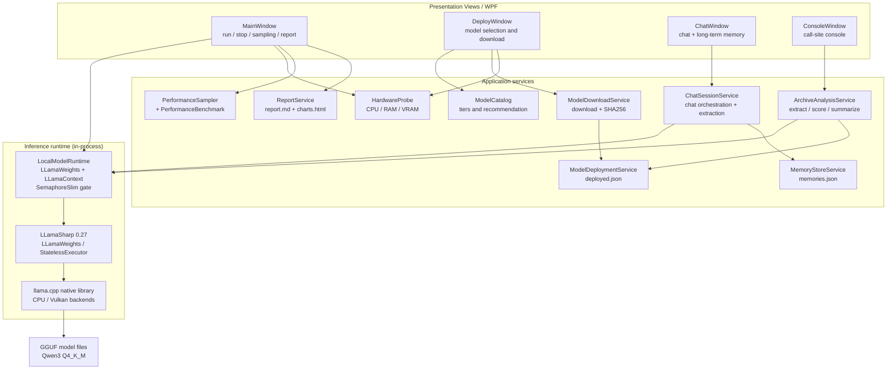

<p>
  <a href="../README.md"></a>
  <a href="README-en-US.md"></a>
  <a href="README-ja-JP.md"></a>
</p>

# KfuPet-local-chat

> ⚠️ Important: This is **NOT the KfuPet desktop pet main project**.
>
> This project is **not the main body of the KfuPet desktop pet**, but a standalone local AI chat core and pilot bench.

## 📖 Project Introduction

This is a **fully local** large-model chat implementation. It never calls a cloud AI API. Models are stored locally as GGUF files and inference runs inside the application process through the bundled llama.cpp native library.

It plays two roles:

- the **low-level reference base** for connecting the KfuPet desktop pet to local models;
- a **pilot bench** for validating local model behavior, memory extraction, and performance.

The code is split into presentation, application services, and an inference runtime, so it can be ported to other .NET projects directly.

## ✨ Features

| Feature | Description |
| --- | --- |
| Three local models | Qwen3-1.7B / 4B / 8B, all Q4_K_M, annotated by local VRAM and RAM |
| Download and multi-model management | Custom model folder, multi-URL fallback, incremental SHA256, several models can coexist |
| Device selection | Auto (based on VRAM), GPU acceleration, or CPU only; the choice is persisted |
| Main chat | Multi-turn chat with persona prompt and long-term memory injection; memory extraction runs after every turn |
| Debug console | Replays the main project's call sites: touch reaction, proactive chat, archive extraction, re-scoring, summarization |
| Performance sampling | Every second: CPU, memory, GPU utilization, VRAM, temperature, power, clock |
| Run report | After one complete run, export a ZIP containing a Markdown report and a self-contained HTML chart page |
| Hardware probe | CPU, RAM, dedicated GPU model and real VRAM size |

## 🏗️ Architecture

The project is a **.NET 8 + WPF single-process desktop application**. There is no local HTTP server and no separate inference process; llama.cpp is loaded as a native library into the current process.



### Layer responsibilities

| Layer | Location | Responsibility |
| --- | --- | --- |
| Presentation | [MainWindow.xaml.cs](../MainWindow.xaml.cs), [Views](../Views) | Window and card layout, button dispatch, runtime status, animations, logs |
| Application services | [Services](../Services) | Model catalog, download/deployment, hardware probe, chat orchestration, memory storage, archive analysis, performance sampling, report generation |
| Inference runtime | [LocalModelRuntime.cs](../Services/LocalModelRuntime.cs) | Load GGUF, create context, serialize inference, collect metrics, release VRAM |
| Native inference | LLamaSharp + llama.cpp | Tensor computation; `GpuLayerCount` controls how many layers are offloaded to the GPU |
| Data models | [Models](../Models) | Deployed model, hardware info, run record, memory entries |

### Key design constraints

- **Local only**: no cloud model API; every feature works offline once the model is downloaded.
- **In-process inference**: no Ollama or other external service is required.
- **Single inference gate**: `LocalModelRuntime` uses `SemaphoreSlim(1,1)` so multiple windows cannot use the same native context concurrently.
- **State follows reality**: the UI reads `_runtime.IsRunning` instead of hard-coding status; stopping waits for inference to finish before disposing.
- **Recoverable configuration**: a missing `deployed.json` is rebuilt from the model folder; corrupt settings fall back to defaults.

### Module map

| Module | Responsibility |
| --- | --- |
| [ModelCatalog.cs](../Services/ModelCatalog.cs) | Three-tier catalog, VRAM/RAM checks, recommended tier |
| [ModelDownloadService.cs](../Services/ModelDownloadService.cs) | Streaming download, `.part` file, URL fallback, incremental SHA256, smoothed speed and ETA |
| [ModelDeploymentService.cs](../Services/ModelDeploymentService.cs) | `deployed.json` library, active model, uninstall, rebuild |
| [HardwareProbe.cs](../Services/HardwareProbe.cs) | GPU model and real VRAM from the registry, CPU name, physical RAM |
| [LocalModelRuntime.cs](../Services/LocalModelRuntime.cs) | Load, stop, infer, return first-token latency, output tokens, tokens per second |
| [LlamaLogCollector.cs](../Services/LlamaLogCollector.cs) | Captures llama.cpp logs to recover the actual backend and device |
| [ChatSessionService.cs](../Services/ChatSessionService.cs) | Persona, memory and recent turns; reply generation and per-turn extraction |
| [MemoryStoreService.cs](../Services/MemoryStoreService.cs) | Long-term memory JSON, importance order, 100-entry capacity |
| [ArchiveAnalysisService.cs](../Services/ArchiveAnalysisService.cs) | Batch extraction, re-scoring, summarization |
| [PerformanceSampler.cs](../Services/PerformanceSampler.cs) | Per-second CPU/memory and `nvidia-smi` sampling |
| [PerformanceBenchmark.cs](../Services/PerformanceBenchmark.cs) | Fixed short-prompt and long-prompt benchmarks with warm-up |
| [RunHistoryService.cs](../Services/RunHistoryService.cs) | Last 20 complete runs for cross-model comparison |
| [ReportService.cs](../Services/ReportService.cs) | Markdown report and self-contained HTML charts |
| [AppPaths.cs](../Services/AppPaths.cs) / [AppSettingsService.cs](../Services/AppSettingsService.cs) | Data directory conventions and user settings |

## 🔄 How a model is started

1. **Prepare the model**: choose a tier in the download window. On completion the record is written to `deployed.json` and the new model becomes the active one.
2. **Start**: “Run local” enters [StartModelAsync](../MainWindow.xaml.cs#L331-L411), which reads the active deployment; without one it asks the user to deploy first.
3. **Choose the device**: [HardwareProbe.Detect](../Services/HardwareProbe.cs#L15-L24) returns the dedicated GPU and VRAM; the user choice or the auto rule decides `useGpu`.
4. **Load weights**: [LocalModelRuntime.StartAsync](../Services/LocalModelRuntime.cs#L27-L63) runs on a background thread, builds `ModelParams`, calls `LLamaWeights.LoadFromFile`, then `CreateContext`.
5. **Infer**: each request creates a `StatelessExecutor`, applies the chat template inside the GGUF, and streams tokens; `PerformanceSampler` records resources every second.
6. **Stop**: `StopWhenIdleAsync` waits for the gate, then disposes context and weights. One complete start-to-stop cycle creates a run record and enables report export.

### Device rules

```text
Auto:
  dedicated GPU and VRAM >= model file size × 1.2  → GPU (GpuLayerCount = 999)
  otherwise                                        → CPU (GpuLayerCount = 0)

Forced GPU: falls back to CPU when no dedicated GPU exists, with a log note
Forced CPU: GpuLayerCount = 0
```

VRAM is read from the registry key `HardwareInformation.qwMemorySize`, not from WMI `AdapterRAM`, which truncates values above 4 GB.

### Inference parameters

| Parameter | Value | Notes |
| --- | --- | --- |
| `ContextSize` | 8192 | Context window |
| `GpuLayerCount` | 999 / 0 | 999 offloads as many layers as possible |
| `ApplyTemplate` | `true` | Uses the Qwen3 template embedded in the GGUF |
| `SystemMessage` | Persona + up to 8 memories | Assembled by `ChatSessionService` |
| `AntiPrompts` | `<\|im_end\|>`, `<\|endoftext\|>` | Stop generation when hit |
| Chat `MaxTokens` | 96 | Short replies |
| Extraction `MaxTokens` | 192 | Structured JSON |
| Prompt suffix | `/no_think` | Suppresses Qwen3 thinking; `<think>` is also stripped as a fallback |

## 🧠 Model tiers

| Model | Quantization | Download | Min VRAM | Min RAM | CPU only | Memory extraction |
| --- | --- | --- | --- | --- | --- | --- |
| Qwen3-1.7B-Instruct | Q4_K_M | ~1.1 GB | 2 GB | 4 GB | Yes | No |
| Qwen3-4B-Instruct-2507 | Q4_K_M | ~2.5 GB | 4 GB | 8 GB | Yes (slow) | Yes |
| Qwen3-8B | Q4_K_M | ~5.0 GB | 6 GB | 8 GB | Practically no | Yes |

4B is the default tier. The recommended tier is the largest model that can run smoothly; when it is also the default tier, only the default badge is shown. Insufficient tiers remain visible but require confirmation before continuing.

## 💾 Data and configuration

Default directory: `%AppData%\KfuPetLocalChat` (the model folder can be changed in the download window).

| Path | Content |
| --- | --- |
| `Models\*.gguf` | Downloaded models; multiple models coexist |
| `Config\deployed.json` | Model library and active model; rebuilt from the folder if missing |
| `Config\settings.json` | Custom model directory, inference device |
| `Config\memories.json` | Long-term memory, at most 100 entries, importance order |
| `Config\runhistory.json` | Summaries of the last 20 complete runs |

“Clear all data” removes long-term memory, run history and archive copies under `data/`. It **does not delete GGUF files** and does not reset the model folder or device setting.

## 🖥️ UI overview

- **Main window**: data-source and engine cards on the left; action bar, result card and live log on the right. Panels fade in and rise on startup.
- **Download window**: local hardware, per-tier status, storage path and download progress with GB conversion and ETA.
- **Chat window**: conversation on the left, long-term memory on the right; extraction runs after each reply, and 1.7B explicitly reports that extraction is skipped.
- **Console window**: opens maximized; call-site output on top, local model result card below; archive batch extraction runs here.

## 📊 Observability and reports

- [PerformanceSampler](../Services/PerformanceSampler.cs) samples once per second: process CPU, process memory, and `nvidia-smi` utilization, VRAM, temperature, power and clock.
- Two fixed benchmarks run in the background after startup, with a short warm-up so Vulkan shader compilation does not pollute first-token latency.
- Throttling ratio is estimated as “clock below 90% of max and utilization above 50%”.
- Export is a ZIP with `report.md` (hardware, model, backend, offload, context, SHA256, benchmarks, samples, history, logs) and `charts.html` (self-contained line and bar charts).

## 📂 Directory layout

```text
kfupet-local-chat/
├─ App.xaml / App.xaml.cs        # entry point; registers the llama.cpp log callback
├─ MainWindow.xaml(.cs)          # main window: cards, run/stop, sampling, reports
├─ Models/                       # deployment, hardware, run and memory records
├─ Services/                     # application service layer
├─ Views/                        # cards and child windows
├─ Resources/Theme.xaml          # global styles and animation resources
├─ data/ArchiveMemory.json       # sample archive memory
├─ docs/                         # localized READMEs and call-site list
└─ kfupet-local-chat.csproj      # net8.0-windows + LLamaSharp packages
```

## 🚀 Build and run

Requirements:

- Windows 10 / 11 x64
- .NET 8 SDK
- 16 GB RAM recommended; a matching VRAM tier is needed for 4B / 8B

```powershell
dotnet restore
dotnet build
dotnet run --project kfupet-local-chat.csproj
```

First run:

1. Open the download window, confirm hardware and recommendation, choose a folder and download;
2. Click “Run local” and wait for “started” in the log;
3. Click “Open console” to chat or exercise other call sites;
4. After stopping the model, “Export report” becomes available.

## ⚠️ Technical notes and pitfalls

- **LLamaSharp is pinned to 0.27.0**: 0.30 relies on net10 native loading and falls back to netstandard2.0 on net8, which fails.
- **VRAM probing**: WMI `AdapterRAM` truncates above 4 GB; use registry `HardwareInformation.qwMemorySize`.
- **Device detection**: Vulkan device indices in llama.cpp logs may not match physical order; the report prefers log lines that name the device.
- **Qwen3 thinking**: 1.7B / 8B emit `<think>` content by default; append `/no_think` and strip `<think>` as a fallback.
- **WPF details**: a 6px custom scrollbar needs `MinWidth=0`; a custom ComboBox needs both `ItemTemplate` and `TextSearch.TextPath`, plus wheel interception when collapsed.

## 📌 Scope

- This is a **learning and reference base**, not the desktop pet itself; pet window behavior, emotion systems and the full memory system are out of scope.
- Windows only.
- Optimized for short replies plus structured extraction, not general long-form generation.

## 📄 License

Apache-2.0

Licensed under the [Apache License 2.0](../LICENSE).
