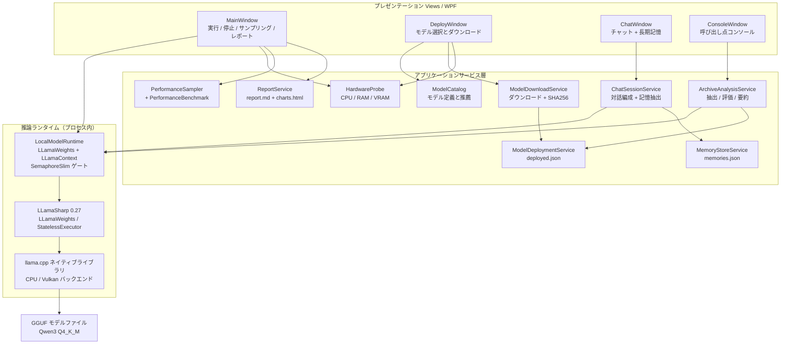

<p>
  <a href="../README.md"></a>
  <a href="README-en-US.md"></a>
  <a href="README-ja-JP.md"></a>
</p>

# KfuPet-local-chat

> ⚠️ Important: This is **NOT the KfuPet desktop pet main project**.
>
> 本プロジェクトは **KfuPet のデスクトップペット本体ではありません**。独立したローカル AI チャットコア兼パイロット環境です。

## 📖 プロジェクト紹介

本プロジェクトは **完全ローカル** の大規模モデルチャット実装です。クラウド AI API は一切呼び出しません。モデルは GGUF ファイルとしてローカルに保存され、推論は同梱の llama.cpp ネイティブライブラリによってアプリケーションプロセス内で実行されます。

次の 2 つの役割を持ちます。

- KfuPet デスクトップペットがローカルモデルへ接続するための **下位レベルの参考基盤**
- ローカルモデルの挙動、記憶抽出、性能を検証する **パイロット環境**

コードはプレゼンテーション層、アプリケーションサービス層、推論ランタイムに分かれており、他の .NET プロジェクトへ移植しやすい構成です。

## ✨ 機能一覧

| 機能 | 説明 |
| --- | --- |
| 3 種類のローカルモデル | Qwen3-1.7B / 4B / 8B、すべて Q4_K_M。VRAM と RAM に応じて実行可否を表示 |
| ダウンロードと複数モデル管理 | 保存先の変更、複数 URL へのフォールバック、SHA256 の同時計算、複数モデルの共存 |
| 推論デバイスの選択 | 自動（VRAM で判断）/ GPU 加速 / CPU のみ。設定は永続化 |
| メインチャット | ペルソナと長期記憶を注入したマルチターン対話。毎ターン終了後に記憶抽出を実行 |
| デバッグコンソール | タッチ反応、自発的な話しかけ、アーカイブ一括抽出、単条再評価、複数要約などの呼び出し点を再現 |
| 性能サンプリング | 毎秒 CPU、メモリ、GPU 使用率、VRAM、温度、消費電力、クロックを記録 |
| 実行レポート | 完全な 1 回の実行後に ZIP を出力。Markdown レポートと自己完結型 HTML グラフを含む |
| ハードウェア検出 | CPU、メモリ、専用 GPU の型番と実際の VRAM |

## 🏗️ アーキテクチャ

**.NET 8 + WPF のシングルプロセスデスクトップアプリ**です。ローカル HTTP サーバーも独立した推論プロセスもなく、llama.cpp はネイティブライブラリとして現在のプロセスに読み込まれます。



### 各層の責務

| 層 | 場所 | 責務 |
| --- | --- | --- |
| プレゼンテーション | [MainWindow.xaml.cs](../MainWindow.xaml.cs)、[Views](../Views) | ウィンドウとカードの配置、ボタン振り分け、実行状態表示、アニメーション、ログ |
| アプリケーションサービス | [Services](../Services) | モデルカタログ、ダウンロードと配置、ハードウェア検出、対話編成、記憶保存、アーカイブ分析、性能サンプリング、レポート生成 |
| 推論ランタイム | [LocalModelRuntime.cs](../Services/LocalModelRuntime.cs) | GGUF の読み込み、コンテキスト作成、推論の直列化、指標収集、VRAM 解放 |
| ネイティブ推論 | LLamaSharp + llama.cpp | 実際のテンソル計算。`GpuLayerCount` で GPU へオフロードする層数を決める |
| データモデル | [Models](../Models) | 配置記録、ハードウェア情報、実行記録、記憶項目 |

### 主要な設計方針

- **完全ローカル**：クラウドモデル API を参照せず、ダウンロード後はオフラインでも動作する。
- **プロセス内推論**：Ollama などの外部サービスを必要としない。
- **単一推論ゲート**：`LocalModelRuntime` が `SemaphoreSlim(1,1)` で全推論を直列化し、複数ウィンドウが同じネイティブコンテキストを奪い合わないようにする。
- **状態をハードコードしない**：UI は常に `_runtime.IsRunning` を参照し、停止時は推論完了を待ってから破棄する。
- **設定の復元**：`deployed.json` が消失した場合はモデルフォルダから再構築し、設定破損時は既定値へフォールバックする。

### モジュール一覧

| モジュール | 責務 |
| --- | --- |
| [ModelCatalog.cs](../Services/ModelCatalog.cs) | 3 段階のモデル定義、VRAM / RAM 判定、推薦モデル選択 |
| [ModelDownloadService.cs](../Services/ModelDownloadService.cs) | ストリーミングダウンロード、`.part` ファイル、URL フォールバック、SHA256 同時計算、平滑化した速度と残り時間 |
| [ModelDeploymentService.cs](../Services/ModelDeploymentService.cs) | `deployed.json` の複数モデル管理、現在モデル切替、アンインストール、自動再構築 |
| [HardwareProbe.cs](../Services/HardwareProbe.cs) | レジストリから GPU 型番と実 VRAM、CPU 名、物理メモリを取得 |
| [LocalModelRuntime.cs](../Services/LocalModelRuntime.cs) | 読み込み / 停止 / 推論、初回トークン遅延、出力トークン数、生成速度を返す |
| [LlamaLogCollector.cs](../Services/LlamaLogCollector.cs) | llama.cpp のログコールバックを登録し、実際のバックエンドとデバイスを復元 |
| [ChatSessionService.cs](../Services/ChatSessionService.cs) | ペルソナ、長期記憶、直近対話を組み立て、返答生成と毎ターン抽出を実行 |
| [MemoryStoreService.cs](../Services/MemoryStoreService.cs) | 長期記憶 JSON、重要度順、容量 100 件、超過時は低優先度を削除 |
| [ArchiveAnalysisService.cs](../Services/ArchiveAnalysisService.cs) | アーカイブ一括抽出、単条再評価、複数要約 |
| [PerformanceSampler.cs](../Services/PerformanceSampler.cs) | 毎秒のプロセス CPU / メモリと `nvidia-smi` 指標のサンプリング |
| [PerformanceBenchmark.cs](../Services/PerformanceBenchmark.cs) | 起動後の固定ベンチマーク 2 種（短文 / 長文）。ウォームアップ付き |
| [RunHistoryService.cs](../Services/RunHistoryService.cs) | 直近 20 回の完全実行サマリー。モデル間比較に使用 |
| [ReportService.cs](../Services/ReportService.cs) | Markdown レポートと自己完結型 HTML グラフの生成 |
| [AppPaths.cs](../Services/AppPaths.cs) / [AppSettingsService.cs](../Services/AppSettingsService.cs) | データディレクトリ規約とユーザー設定の読み書き |

## 🔄 モデル起動の流れ

1. **モデルを準備**：ダウンロード画面でモデルを選ぶ。完了後に `deployed.json` へ記録し、そのモデルを現在のモデルにする。
2. **起動**：「ローカル実行」で [StartModelAsync](../MainWindow.xaml.cs#L331-L411) に入る。配置記録がなければ先に配置を促す。
3. **デバイス判定**：[HardwareProbe.Detect](../Services/HardwareProbe.cs#L15-L24) で専用 GPU と VRAM を取得し、ユーザー選択または自動ルールで `useGpu` を決める。
4. **重みの読み込み**：[LocalModelRuntime.StartAsync](../Services/LocalModelRuntime.cs#L27-L63) がバックグラウンドスレッドで `ModelParams` を作成し、`LLamaWeights.LoadFromFile` で GGUF を読み、`CreateContext` で KV キャッシュを確保する。
5. **推論**：リクエストごとに `StatelessExecutor` を作り、GGUF 内の対話テンプレートを適用してトークンをストリーミングする。`PerformanceSampler` が毎秒リソースを記録する。
6. **停止**：`StopWhenIdleAsync` がゲートの空きを待ってからコンテキストと重みを破棄する。1 回の「起動 → 停止」で実行記録が作られ、レポート出力が有効になる。

### デバイス判定ルール

```text
自動：
  専用 GPU があり、VRAM >= モデルファイルサイズ × 1.2  → GPU（GpuLayerCount = 999）
  それ以外                                            → CPU（GpuLayerCount = 0）

手動 GPU：専用 GPU がない場合は CPU へ自動的に切り替え、ログに理由を出す
手動 CPU：GpuLayerCount = 0 を強制
```

VRAM は WMI の `AdapterRAM`（4 GB 超で切り捨て）ではなく、レジストリ `HardwareInformation.qwMemorySize` から取得します。

### 推論パラメータ

| パラメータ | 値 | 説明 |
| --- | --- | --- |
| `ContextSize` | 8192 | コンテキスト長 |
| `GpuLayerCount` | 999 / 0 | 999 は可能な限り GPU へオフロード |
| `ApplyTemplate` | `true` | GGUF 内蔵の Qwen3 対話テンプレートを使用 |
| `SystemMessage` | ペルソナ + 最大 8 件の長期記憶 | `ChatSessionService` が組み立て |
| `AntiPrompts` | `<\|im_end\|>`、`<\|endoftext\|>` | 一致したら生成終了 |
| チャット `MaxTokens` | 96 | 短文スタイルを維持 |
| 抽出 `MaxTokens` | 192 | 構造化 JSON |
| プロンプト末尾 | `/no_think` | Qwen3 の思考出力を抑制し、`<think>` も除去 |

## 🧠 モデル構成

| モデル | 量子化 | ダウンロード | 最低 VRAM | 最低 RAM | CPU のみ | 記憶抽出 |
| --- | --- | --- | --- | --- | --- | --- |
| Qwen3-1.7B-Instruct | Q4_K_M | 約 1.1 GB | 2 GB | 4 GB | 可 | 非対応 |
| Qwen3-4B-Instruct-2507 | Q4_K_M | 約 2.5 GB | 4 GB | 8 GB | 可（低速） | 対応 |
| Qwen3-8B | Q4_K_M | 約 5.0 GB | 6 GB | 8 GB | 実質不可 | 対応 |

4B が既定モデルです。推薦モデルは「快適に動作する最大のモデル」で、既定モデルと一致する場合は既定ラベルのみ表示します。構成不足のモデルも表示されますが、次へ進む際に確認警告が出ます。

## 💾 データと設定

既定ディレクトリ：`%AppData%\KfuPetLocalChat`（モデル保存先はダウンロード画面で変更可能）。

| パス | 内容 |
| --- | --- |
| `Models\*.gguf` | ダウンロード済みモデル。複数共存可能 |
| `Config\deployed.json` | モデル一覧と現在のモデル。消失時はフォルダから再構築 |
| `Config\settings.json` | モデル保存先、推論デバイス |
| `Config\memories.json` | 長期記憶。最大 100 件、重要度順 |
| `Config\runhistory.json` | 直近 20 回の完全実行サマリー |

「すべてのデータを削除」は長期記憶、実行履歴、`data/` 配下のアーカイブ副本のみを削除します。**GGUF ファイルは削除せず**、モデル保存先とデバイス設定もリセットしません。

## 🖥️ 画面構成

- **メインウィンドウ**：左にデータソースと推論エンジンのカード、右に操作バー、結果カード、ログ。起動時にフェードインとパネルの順次表示アニメーションがある。
- **ダウンロード画面**：本機のハードウェア、各モデルの実行状態、保存先選択、GB 換算と残り時間付きの進捗表示。
- **メインチャット画面**：左に対話、右に長期記憶。毎ターン後に自動抽出し、1.7B ではスキップを明示する。
- **コンソール画面**：既定で最大化表示。上に呼び出し点の出力、下にローカルモデルの結果カード。アーカイブ一括抽出はここで実行する。

## 📊 性能計測とレポート

- [PerformanceSampler](../Services/PerformanceSampler.cs) は毎秒 1 回、プロセス CPU、プロセスメモリ、`nvidia-smi` の使用率、VRAM、温度、消費電力、クロックを記録する。
- 起動後に固定ベンチマーク 2 種（短文対話 / 長文抽出）をバックグラウンドで実行する。Vulkan シェーダーコンパイルが初回トークン遅延に混ざらないよう、最初に短いウォームアップを行う。
- スロットリング比率は「最高クロックの 90% 未満かつ使用率 50% 超」で推定する。
- 出力は ZIP：`report.md`（ハードウェア、モデル、バックエンド、レイヤーオフロード、コンテキスト、SHA256、ベンチマーク、サンプル、履歴、ログ）と `charts.html`（自己完結型の折れ線・棒グラフ）。

## 📂 ディレクトリ構成

```text
kfupet-local-chat/
├─ App.xaml / App.xaml.cs        # エントリポイント。llama.cpp ログコールバックを登録
├─ MainWindow.xaml(.cs)          # メインウィンドウ：カード、実行/停止、サンプリング、レポート
├─ Models/                       # 配置、ハードウェア、実行、記憶のデータオブジェクト
├─ Services/                     # アプリケーションサービス層
├─ Views/                        # カードと子ウィンドウ
├─ Resources/Theme.xaml          # グローバルスタイルとアニメーションリソース
├─ data/ArchiveMemory.json       # アーカイブ記憶のサンプル
├─ docs/                         # 多言語 README と呼び出し点一覧
└─ kfupet-local-chat.csproj      # net8.0-windows + LLamaSharp
```

## 🚀 ビルドと実行

必要条件：

- Windows 10 / 11 x64
- .NET 8 SDK
- 16 GB メモリ推奨。4B / 8B には対応する VRAM が必要

```powershell
dotnet restore
dotnet build
dotnet run --project kfupet-local-chat.csproj
```

初回の流れ：

1. ダウンロード画面でハードウェアと推薦を確認し、保存先を選んでダウンロード；
2. 「ローカル実行」を押し、ログに「起動済み」が出るまで待つ；
3. 「コンソール起動」でチャットや他の呼び出し点を試す；
4. モデル停止後に「レポート出力」が有効になる。

## ⚠️ 技術メモと既知の注意点

- **LLamaSharp は 0.27.0 固定**：0.30 のネイティブライブラリは net10 の動的読み込みに依存し、net8 では netstandard2.0 へフォールバックして失敗する。
- **VRAM 取得**：WMI `AdapterRAM` は 4 GB 超で切り捨てられるため、レジストリ `HardwareInformation.qwMemorySize` を使う。
- **デバイス識別**：llama.cpp ログの Vulkan デバイス番号は物理順と一致しないことがあるため、レポートは型番を含む行を優先して解析する。
- **Qwen3 の思考出力**：1.7B / 8B は既定で `<think>` を出す。プロンプト末尾に `/no_think` を付け、表示前に `<think>` を除去する。
- **WPF の細部**：6 px の細いスクロールバーには `MinWidth=0` が必要。カスタム ComboBox は `ItemTemplate` と `TextSearch.TextPath` の両方を設定し、閉じた状態のホイール操作を遮断する。

## 📌 適用範囲

- 本プロジェクトは **学習・参考用のローカル接続基盤**であり、デスクトップペット本体ではありません。ペットのウィンドウ挙動、感情システム、完全な記憶システムは含みません。
- Windows のみ対応。
- 短文対話と構造化情報の抽出を主目的とし、汎用的な長文生成は対象外です。

## 📄 ライセンス

Apache-2.0

本プロジェクトは [Apache License 2.0](../LICENSE) で公開されています。
